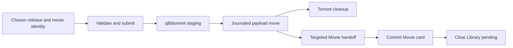

# Movie Downloads and Import code map

[Decisions and evidence](../second-brain/movie-downloads-and-import.md) · [Atlas index](README.md) · [Movie Library and Identity Review](movie-library-and-identity-review.md) · [TV Downloads and Import](tv-downloads-and-import.md)

For a followed title, start with the [Movie Follow scan and source review](movie-follow.md) before tracing transfer completion here.

**Source checked** · 2026-11-07 on `master` at `be511f9`, with local changes in Movie acquisition, app wiring, and ingestion. PID `51196` on port 5000 served `/assets/index-Cok6xiDI.js` during the documentation pass. Live transfer and import behavior remain unverified.

## Choose and submit a release

| Entry point | Owner and result |
| --- | --- |
| **Shared Source Review** | Home, Discover, Movie Lists, and AI Control use `previewSourceReview`. `POST /api/sources/review/preview` → `source_review_preview` selects the shared or AI policy and calls `MovieAcquisition.review`. A stable identity and an eligible variant at the selected quality determine which rows are ready. `SourceReviewDialog` normally sends selected ready rows to `source_review_submit`; some callers supply their own review-completion callback. The shared submit route rechecks ownership, then `_ai_control_submit_download` checks the selected resolution and calls `_submit_qbittorrent_candidate`. [Shared client](../../src/api/sourceReview.js) · [Review dialog](../../src/components/SourceReviewDialog.jsx) · [Routes](../../app.py) · [Selection owner](../../services/movie_acquisition.py) |
| **Direct release action** | `TorrentActions` sends the release, expected hash and size, and Movie ID to `POST /api/qbittorrent/submit` → `qbittorrent_submit` in embedded mode. That handler checks stable identity and ownership or explicit Upgrade. The direct action in system-client mode opens the magnet externally. [Release action](../../src/components/TorrentActions.jsx) · [Submission route](../../app.py) |
| **Validate and stage** | `_submit_qbittorrent_candidate` resolves a supported Prowlarr download and checks the transport against the selected infohash. It delegates to `QBittorrentManager.submit_torrent` or `submit_magnet`. `validate_torrent_manifest` checks safe paths and expected release evidence. Magnets can wait for metadata validation before payload transfer. The manager stages the payload outside Movie roots and writes the job under the infohash in `jobs.json`. [Transport adapter](../../app.py) · [Validation and transfer owner](../../services/qbittorrent.py) |

## Two completion records

1. **Transfer and file move** · `DownloadImportMonitor` calls `QBittorrentManager.process_completed` while embedded monitoring is enabled. For normal completed Movie jobs it pauses the torrent, then `QBittorrentJobStore.move_completed_payload` journals and moves the payload to the recorded destination. `_finish_completed_import` removes the torrent without files after a successful move. A move failure or unresolved destination collision preserves recovery information. `cleanup_failed` can mean the files already moved and only torrent removal failed. The manager also handles earlier job records that explicitly carry a saved copy or hardlink mode. [Monitor](../../services/download_monitor.py) · [Transfer and move journal](../../services/qbittorrent.py)
2. **Identity and publication** · `_handle_completed_qbittorrent_imports` checks `imported_paths` against Movie roots and discovers videos only within the imported payload. `_completed_download_video_paths` deduplicates and orders largest first, with normalized-path ties. The handoff queues `LibraryIngestionCoordinator.reconcile_paths` with `require_publication=True` and the recorded identity inputs. `_apply_completed_download_identity` resolves a stable ID inside the coordinator's retry work. A resolved hint targets the primary video. Deferred resolution can use the discovered video targets. A failed lookup has no completion-eligible targets. `_apply_ingestion_identity_hint` preserves accepted and manual identities. [Handoff and identity ports](../../app.py) · [Coordinator](../../services/library_ingestion.py) · [Identity and card map](movie-library-and-identity-review.md)
3. **Acknowledge Library completion** · The coordinator persists `_ingestion_retry` in the Movie catalog. `CatalogRepository.publication_status` reports readiness and `publication_committed` separately. `final_card_publication` owns the committed transition. For an in-library handoff, the bridge sets `identity_handoff.state='applied'` and clears `library_scan_pending` only after the required targets have committed. An imported payload outside Movie roots is explicitly deferred with its pending flag cleared. [Bridge](../../app.py) · [Publication owner](../../services/catalog_repository.py) · [Approved handoff rules](../plans/2026-10-23-movie-library-search-and-retry-performance.md#completed-download-bridge-and-completion-refresh)

## Finished in qBittorrent, pending in CP

**Downloads → Movies / qBittorrent** embeds the qBittorrent WebUI. Match the torrent infohash to the CP record in `<user data>/qbittorrent/jobs.json` through `GET /api/qbittorrent/jobs`. Inspect `state`, `last_error`, `destination`, `payload_paths`, `transfer_plan`, `imported_paths`, `library_scan_pending`, and `identity_handoff`. If the hash has no CP job, check whether the torrent entered the client outside CP's managed submission flow. If the job remains `downloading` at 100%, `GET /api/qbittorrent/status` exposes `import_monitor` with its last check, last success, and error. For Library state, check the exact path in File View and the coordinator's publication and retry evidence. [Downloads UI](../../src/features/downloads/DownloadsWorkspace.jsx) · [Job and monitor status routes](../../app.py) · [Monitor status test](../../tests/test_download_monitor.py) · [Library diagnosis](movie-library-and-identity-review.md#file-on-disk-missing-or-wrong-in-movie-view)

| Job evidence | What it means and which recovery applies | Existing tests |
| --- | --- | --- |
| **`move_failed` or `destination_conflict`** | Check `last_error`, the destination and the transfer plan. The existing job can replay a recoverable move. A conflict with unchanged source and destination signatures waits for the evidence to change. Inspect the saved paths before moving anything manually. | `test_manager_keeps_torrent_when_destination_conflicts`, `test_manager_keeps_torrent_when_filesystem_move_fails`, and `test_import_resumes_after_one_payload_was_already_moved`. [Transfer tests](../../tests/test_qbittorrent_service.py) |
| **`payload_imported` or `cleanup_failed`** | The move reached its checkpoint. Verify the imported path and let the existing completion path finish torrent cleanup. That step uses the recorded job. An in-library `cleanup_failed` result can still enter the Movie handoff. | `test_manager_removes_torrent_only_after_payload_import_succeeds`, `test_manager_retries_torrent_cleanup_without_moving_payload_twice`, and `test_manager_recovers_finalizing_job_after_torrent_was_removed`. [Completion tests](../../tests/test_qbittorrent_service.py) |
| **`imported` with `library_scan_pending=true`** | The payload arrived. Inspect `identity_handoff` and the retry ledger for a queued, deferred, or failed handoff. The existing monitor can replay eligible work after restart. Repeated ticks preserve the same retry budget for unchanged evidence. An exhausted or permanent Library stage stays blocked. **Rescan library files** sends `force_scan=1` and can re-arm blocked ingestion. This acts on the Library, separate from transfer recovery. | `test_completed_video_uses_exact_path_coordinator_and_keeps_journal_pending_until_commit`, `test_manager_replays_imported_job_with_pending_library_scan_after_restart`, `test_failed_identity_handoff_remains_pending_for_restart_recovery`, and `test_provider_failure_reserves_before_side_effect_and_poll_restart_cannot_reset`. [Bridge test](../../tests/test_qbittorrent_api.py) · [Journal tests](../../tests/test_qbittorrent_service.py) · [Identity recovery](../../tests/test_sql_migration_parity.py) · [Retry tests](../../tests/test_movie_publication_retries.py) |
| **Deferred outside Movie roots** | Compare `imported_paths` with configured Movie roots. The move can succeed to an external destination while automatic Library discovery is deferred and the pending flag is cleared. Treat the destination and the catalog as separate evidence. | `test_imported_job_outside_library_is_deferred_once_not_replayed_forever` asserts the deferred reason and cleared pending flag. [Outside-library test](../../tests/test_sql_migration_parity.py) · [Bridge](../../app.py) |

**Hybrid torrent IDs** · `QBittorrentManager.torrents_by_info_hash` resolves a unique alternate v1 or v2 ID when qBittorrent reports a different primary ID. Completion keeps the existing CP journal key and uses the client's primary ID for client calls. `_process_completed_locked` can revalidate a completed Movie magnet that timed out waiting for metadata if it finds the matching alternate ID and the job meets the recovery conditions. Check `test_manager_validates_a_hybrid_magnet_using_the_clients_primary_id` and `test_manager_recovers_a_completed_hybrid_movie_after_the_old_timeout`. [Manager](../../services/qbittorrent.py) · [Hybrid recovery tests](../../tests/test_qbittorrent_service.py) · [November recovery record](../plans/2026-11-09-hybrid-torrent-id-import.md)

**Replay versus Submit** · `POST /api/qbittorrent/finalize` → `qbittorrent_finalize` runs completion processing on existing jobs and can move files, remove torrents, and enqueue Library work. The enabled monitor normally handles that same pipeline. A new release submission is a separate operation. For the same hash, `submit_magnet` can return an existing job or `recovery_pending` if the recorded payload is recoverable. Stale jobs without recoverable evidence can follow a resubmission path. [Finalize route](../../app.py) · [Magnet recovery guard](../../services/qbittorrent.py) · [Recovery and duplicate tests](../../tests/test_qbittorrent_service.py)

## Other checks and boundaries

- **Release and ownership checks** · `test_source_review_requires_a_stable_identity_before_search`, `test_source_review_rechecks_an_unflagged_movie_that_became_owned`, and `test_submit_blocks_a_prowlarr_redirect_to_a_different_release_hash`. [Source review tests](../../tests/test_sql_migration_parity.py) · [Transport tests](../../tests/test_qbittorrent_api.py)
- **Replay and identity protection** · `test_manager_does_not_resubmit_job_with_recoverable_payload` and `test_job_hint_cannot_replace_manual_identity_during_final_card_work`. A release hint and an explicit identity correction have separate owners. [Job tests](../../tests/test_qbittorrent_service.py) · [Ingestion protection tests](../../tests/test_library_ingestion_paths.py) · [Manual identity map](movie-library-and-identity-review.md#review-and-correction-entry-points)
- **TV boundary** · `QBittorrentManager` dispatches TV jobs to the native TV handler for episode verification and binding. The Movie bridge processes Movie jobs. [TV completion map](tv-downloads-and-import.md)
