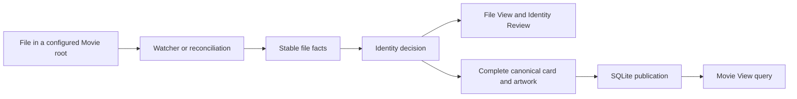

# Movie Library and Identity Review code map

[Decisions and evidence](../second-brain/movie-library-and-identity-review.md) · [Atlas index](README.md) · [TV Library and Maintenance](tv-library-and-maintenance.md)

**Source checked** · 2026-11-07 on `master` at `be511f9`, with local changes in the Movie frontend, ingestion, and catalog. PID `51196` on port 5000 served `/assets/index-Cok6xiDI.js` during the documentation pass. Current live ingestion, matching, and correction remain unverified.

## From a Movie folder to a visible card

| Stage | Owner and result |
| --- | --- |
| **Configured roots and discovery** | Settings reads and saves Movie directories through `/api/config`. `app.py` resolves `movies_dirs` through `get_movies_dirs`, and `_iter_video_files` walks reachable roots for supported video extensions. Native `LibraryObserverAdapter` events and `LibraryStartupCatchup` feed the ingestion coordinator. A filesystem event is a hint. The inventory and committed catalog show what CP recorded. [Settings](../../src/features/settings/SettingsWorkspace.jsx) · [Roots and scan](../../app.py) · [Watcher](../../services/library_observer.py) · [Startup catch-up](../../services/library_startup_catchup.py) |
| **Reconciliation and file facts** | `app.py::_library_ingestion_coordinator` wires `LibraryIngestionCoordinator`. `reconcile_path_now` is the synchronous single-path entry point. The coordinator owns stability checks, probing, identity and asset work, retry, and final publication ordering. `GET /api/library/reconcile` reads status. `POST /api/library/reconcile` starts reconciliation, and `GET /api/library?view=cards&force_scan=1` can also trigger scan work. `GET /api/library/ingestion/status` exposes coordinator and observer state. [Routes and wiring](../../app.py) · [Coordinator](../../services/library_ingestion.py) · [Measured file facts](../../services/media_file_facts.py) |
| **Movie identity** | `_migrate_metadata_path` resolves or revalidates identity under the active provider. `_resolve_tmdb_identity` uses saved manual matches and provider evidence. `evaluate_identity` supplies the evidence-based automatic decision. Accepted identity and review status are stored with the file record. Provider enrichment supplies card metadata. The logical `app_metadata/files.json` and `app_metadata/manual_matches.json` records are accessed through the SQLite-backed `CatalogRepository`. [Resolver wiring](../../app.py) · [Decision owner](../../services/identity_decision.py) · [Accepted identity projection](../../services/authoritative_identity.py) · [SQLite repository](../../services/catalog_repository.py) |
| **Publish a complete card** | `CatalogRepository.publication_status` reports required stages without publishing. `final_card_publication` checks stable facts, accepted identity, complete canonical card data and poster readiness. It commits the publication marker and media generation. The coordinator emits a catalog-ready event after the commit. The installed catalog path is chosen per user data directory, while portable mode uses `catalog.sqlite` in that directory. [Publication and path owner](../../services/catalog_repository.py) · [Canonical card](../../services/canonical_catalog.py) · [Event wiring](../../app.py) · [Browser event consumer](../../src/api/catalogEvents.js) |
| **Read the Library** | `LibraryWorkspace` reads File View via `GET /api/library?view=files`. Movie View calls `POST /api/library/search/advanced` → `advanced_library_search` → `CatalogRepository.library_page` and `CatalogStore.library_page`. Movie View requires accepted identity and either a `ready` publication marker or a legacy row with no marker. The current query, sort, and page determine where a ready card appears. [Library UI](../../src/features/library/LibraryWorkspace.jsx) · [Routes](../../app.py) · [Catalog read](../../services/catalog_store.py) |

## Review and correction entry points

| Action | Path and effect |
| --- | --- |
| **Maintenance → Identity** | `CleanupWorkspace` uses `GET /api/maintenance/audit?section=identity` → `maintenance_audit`. The response projects catalog rows and Identity Review proposals. Unmatched files need an accepted identity. A file with accepted metadata can separately require verification or conflict review. [Maintenance UI](../../src/features/cleanup/CleanupWorkspace.jsx) · [Route](../../app.py) · [Audit projection](../../services/maintenance_audit.py) |
| **Manual TMDB or Plex match** | The Library's `MetadataCorrectionModal` and Maintenance match dialogs share `src/api/metadata.js`. Explicit Apply calls `POST /api/tmdb/match-apply` → `tmdb_match_apply` or `POST /api/plex/match-apply` → `plex_match_apply`. `AppMetadataStore.apply_tmdb_match` and `apply_plex_match` persist a `user_manual` decision with a manual lock. This chooses the provider identity for the file. [Library modal](../../src/components/MetadataCorrectionModal.jsx) · [Shared client](../../src/api/metadata.js) · [Match owners](../../app.py) |
| **Identity Review audit and selected Apply** | `IdentityReviewPanel` uses the `/api/metadata/identity-audit` job routes. `IdentityAuditCoordinator` owns scan progress and proposals. `identity_audit_apply` handles selected proposal IDs after confirmation in an apply-enabled job. It rejects shadow jobs and changed identity revisions. Identity corrections use the provider accept owners with audit origin. A metadata-discrepancy proposal can instead write a display override. [Review panel](../../src/components/IdentityReviewPanel.jsx) · [Coordinator](../../services/identity_audit.py) · [Apply route](../../app.py) |
| **Display title and year** | `MetadataCorrectionModal` sends `POST /api/metadata/override` to save or `DELETE` to reset through `metadata_override`. The canonical projection applies the saved display values to the accepted identity. This is the path for a title presentation change with correct provider IDs. [Display controls](../../src/components/MetadataCorrectionModal.jsx) · [Override route](../../app.py) · [Canonical projection](../../services/canonical_catalog.py) |

## File on disk, missing or wrong in Movie View

Start with the exact path in **File View** and check the active Movie View filters. The answer depends on where the path is in the flow.

| Evidence | Diagnosis and next check | Existing coverage |
| --- | --- | --- |
| **Outside the scan or absent from the catalog** | Compare the path and file extension against the configured Movie roots and supported formats. Check the inventory and observer or reconciliation state to determine whether CP saw or processed it. The Library's **Rescan library files** action sends the `force_scan=1` request. Status reads use a separate entry point. | `test_path_outside_configured_roots_fails_before_stat_or_probe`, the reconcile GET/POST contract cases, and `test_manual_rescan_runs_reconcile_before_returning_library`. [Path tests](../../tests/test_library_ingestion_paths.py) · [Status versus scan](../../tests/test_library_ingestion_api.py) · [Manual rescan test](../../tests/test_library_reconcile.py) |
| **Publication pending or identity unresolved** | A path in File View can still be waiting for stable facts, accepted identity, enrichment, or artwork. Check its ingestion status and **Maintenance → Identity** if the identity is unresolved. Use the publication assessment to separate matching problems from another incomplete stage. | `test_pending_row_is_hidden_until_atomic_publication_and_is_idempotent` and `test_probe_metadata_and_poster_failures_cannot_publish`. [Publication tests](../../tests/test_final_card_publication.py) |
| **Active filter, sort, or page** | A published card can fall outside the current search or result page. Compare the Movie View query and returned counts or pages with the file's accepted identity before requesting scan or metadata changes. | The desktop case `rapid live typing serializes reads and renders exact identities and reachable count`. [Library search spec](../../tests/e2e/library-search-performance.spec.js) |
| **Wrong provider identity** | Compare the canonical provider IDs and title/year with the intended film. Use a manual provider match for a confirmed wrong movie, or examine and explicitly apply an eligible Identity Review proposal. | `test_manual_tmdb_match_removes_path_from_persisted_identity_review` and `test_shadow_audit_reports_splice_conflict_without_mutating_or_applying`. [Audit API tests](../../tests/test_identity_audit_api.py) |
| **Display override on the right identity** | The provider IDs can be correct while a saved title/year changes the card's presentation. Inspect or reset that override in **Correct movie metadata**. | `test_manual_identity_and_overrides_refresh_library_ownership_stats_and_maintenance` and the desktop case `Library metadata correction searches TMDB and Plex while keeping display edits separate`. [Catalog parity test](../../tests/test_sql_migration_parity.py) · [Desktop correction spec](../../tests/e2e/app-smoke.spec.js) |

**Rescan protection** · The reconciliation path preserves a protected manual match and checks identity revisions around work. `test_changed_manual_identity_is_never_revalidated` covers a later full reconcile, and `test_manual_plex_match_stays_locked_during_tmdb_target_migration` covers a provider migration. `test_manual_choice_arriving_during_provider_work_discards_obsolete_result` covers a user choice during automatic provider work. `test_job_hint_cannot_replace_manual_identity_during_final_card_work` covers a competing download hint. [Full reconcile](../../tests/test_library_reconcile.py) · [Provider migration](../../tests/test_metadata_authority.py) · [Concurrent work and hints](../../tests/test_library_ingestion_paths.py)

**Adjacent paths** · Movie Smart Match has its own preview and Apply routes under `/api/metadata/smart-match`. Completed-download handoff supplies a targeted identity hint to the same ingestion coordinator. Existing TV media uses a separate catalog. [Smart Match entry points](../../app.py) · [Movie Downloads and Import map](movie-downloads-and-import.md) · [TV catalog map](tv-library-and-maintenance.md)
