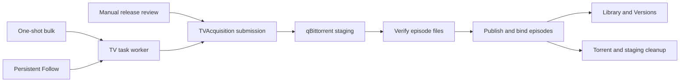

# TV Downloads and Import code map

[Approved behavior and evidence](../second-brain/tv-downloads-and-import.md) · [TV Follow code map](tv-follow.md) · [Atlas index](README.md)

**Source checked** · 2026-11-07 on `master` at `be511f9`, with local changes in the TV frontend, services, contract, and tests. The local homepage on port 5000 was served by PID `36876` with `/assets/index-Cok6xiDI.js` during the documentation pass. Live acquisition and publication remain unverified.

## Entry points

| Surface | Path |
| --- | --- |
| **Expanded TV series** | `TVSeriesPage` uses `downloadTarget` for an episode, selected episodes, or the displayed season. `reviewSeasons` supplies the regular seasons for **Download all seasons** or the seasons selected in **Choose seasons…**. `TVAcquisitionReview` calls `tv_search` at `POST /api/tv/search` or `tv_search_seasons` at `POST /api/tv/search/seasons`. Results show coverage, blockers, and the proposed destination. [Series controls](../../src/features/tv/TVWorkspace.jsx) · [Review dialog](../../src/features/tv/TVAcquisitionReview.jsx) · [Routes](../../services/tv_routes.py) |
| **Submit from release review** | `TVAcquisitionReview` can call `tv_prepare_release` at `POST /api/tv/releases/prepare` for explicit identity confirmation. The Download button calls `tv_submit_batch` at `POST /api/tv/acquisitions/batch` with selected decision tokens, a request key, and the chosen partial and extra-episode options. Reusing the key lets `TVAcquisition.submit_batch` resume unfinished submissions. The single-release `tv_submit` route calls the same `submit` owner. [Review and submission](../../src/features/tv/TVAcquisitionReview.jsx) · [Routes](../../services/tv_routes.py) · [Submission owner](../../services/tv_acquisition.py) |
| **Bulk Download in TV Library, TV Discover, and TV Lists** | Library and Discover use `MediaWorkspace` → `TVWorkspace`. TV Lists mounts `TVBulkActionBar` in `TVListsWorkspace`. The same bar posts selected local series IDs to `/api/tv/bulk/download/preview`, then on confirmation to `/api/tv/bulk/download`. `tv_bulk_download` rechecks previews, saves `kind='bulk'` tasks, and calls `TVMonitoring.start_task`. The worker searches once for released missing episodes and reports misses. [Library and Discover](../../src/features/tv/TVWorkspace.jsx) · [Workspace switcher](../../src/features/tv/MediaWorkspace.jsx) · [TV Lists](../../src/features/movie-lists/TVListsWorkspace.jsx) · [Shared bar](../../src/features/tv/TVBulkActionBar.jsx) · [Bulk routes](../../services/tv_routes.py) · [Worker](../../services/tv_monitoring.py) |
| **Persistent TV Follow** | The task worker selects sources and calls the same TV submission owner. The [TV Follow map](tv-follow.md#worker-and-data) owns the task lifecycle and source-search timing explanation. |

## Submission, publication, and status owners

1. **Destination and submission** · `TVCatalogRepository.resolve_import_destination` evaluates the approved show home and season convention. Explicit home selection uses `tv_import_home` → `set_import_home`. `TVAcquisition.reserve_intent` rechecks the target and destination, calls `reserve_import_home`, and persists the intent. `submit` passes the reserved destination and policy to the transfer owner. New jobs record `tv_lifecycle_version=1`, a move policy, and no seeding. Old jobs continue on their recorded policy in `TVAcquisition.process_completed`. [Catalog owner](../../services/tv_catalog_repository.py) · [Acquisition owner](../../services/tv_acquisition.py)
2. **Transfer and manifest** · The download monitor calls the qBittorrent manager's `process_completed`. `app.py::_get_qbittorrent_manager` wires TV handling to `TVAcquisition`. The manager owns the job journal `jobs.json` and calls `validate_manifest` for TV file selection. The TV handler checks episode identity and coverage and skips recognized auxiliary files. qBittorrent state tracks the transfer. TV acquisition intents, decisions, and events are in `acquisition.sqlite`. [Monitor](../../services/download_monitor.py) · [Manager](../../services/qbittorrent.py) · [App wiring](../../app.py) · [Manifest owner](../../services/tv_acquisition.py) · [Intent store](../../services/acquisition_store.py)
3. **Verified publication** · `TVAcquisition.complete_normal_import` revalidates the snapshotted destination, confirms the manifest, and probes the selected staged videos. `import_verified_files` publishes verified files using the job journal for recovery. `TVCatalogRepository.bind_files` commits `media_files` and `episode_file_bindings` in `tv-catalog.sqlite`. The job records `tv_publication.state='committed'` before torrent removal and `finalize_verified_move` staging cleanup. [Completion owner](../../services/tv_acquisition.py) · [Verified file journal](../../services/verified_import.py) · [Bindings](../../services/tv_catalog_repository.py) · [TV store wiring](../../services/tv_services.py)
4. **Downloads and Library read different evidence** · `TVDownloads` polls `GET /api/tv/acquisitions`, which joins intent history and transfer job status. Its actions use `tv_acquisition_action` → `TVAcquisition.manage`. The expanded Library view reads `GET /api/tv/series/<series_id>/seasons/<season>` → `tv_season` → `season_rows` → `TVCatalogRepository.episodes`. That reads the file bindings and checks whether each file still exists. `TVSeriesPage` renders the returned availability and **Versions**. [Downloads UI](../../src/features/tv/TVDownloads.jsx) · [Routes](../../services/tv_routes.py) · [Episode read](../../services/tv_catalog_repository.py) · [Versions UI](../../src/features/tv/TVWorkspace.jsx)

## Finished transfer, missing episode

Start with the acquisition row in **TV Downloads**. Read its transfer state, destination, imported and failed counts, file-level reasons, and History. Then check the exact episode's binding and file existence through the Library season read. One pack can have a different result for each episode.

| Evidence in Downloads or the job journal | What it means for the episode | Code and tests to check |
| --- | --- | --- |
| `validation_failed`, `needs_review`, or a scheduled import retry before publication | Identity, measured video, destination, or another import check prevented a new binding. Inspect the specific error and whether staging was retained. A scheduled import retry is part of the transfer/import lifecycle. | `validate_manifest`, `complete_normal_import`, and `test_changed_destination_pauses_before_publication` or `test_disk_full_and_failed_probe_never_remove_source_or_publish_bad_binding`. [Import owner](../../services/tv_acquisition.py) · [Import tests](../../tests/test_tv_normal_import.py) |
| `partial_import` with imported and failed files | Only the verified episodes have new bindings. Failed episodes can remain missing. CP retains the recovery payload and records per-file reasons. | `test_partial_pack_publishes_verified_files_and_reports_the_failure` asserts that two of three episode files become available and the failed source remains. [Partial-pack test](../../tests/test_verified_tv_acquisition.py) |
| `cleanup_failed` after the publication checkpoint | The job has committed publication. Verify the current binding and destination file. The episode can already be available while torrent or staging cleanup still needs attention. | `test_torrent_removal_failure_retries_cleanup_without_recopy_or_rebind` asserts the episode is available during cleanup failure and retry completes without remeasuring or rebinding it. [Cleanup recovery test](../../tests/test_tv_normal_import.py) |
| `imported` with a committed binding | Availability still depends on the current catalog binding and existing destination file. Compare the current season response and **Versions** for the episode against the job's destination. | `test_complete_publishes_binding_before_removal_then_deletes_only_own_source` and the desktop case `real isolated completion returns the season binding and renders completed status without rollback`. [Publication test](../../tests/test_tv_normal_import.py) · [Compiled desktop spec](../../tests/e2e/tv-normal-import.spec.js) |

**Retry and rollback** · `TVAcquisition.manage` checks job ownership, blocklist, and the stored retry limit. Cleanup retry uses the existing journal and committed bindings. `rollback_verified_files` is guarded by the recorded policy and verified recovery sources. Once normal-job cleanup begins, retained-source rollback is unavailable. [Action owner](../../services/tv_acquisition.py) · [File recovery](../../services/verified_import.py)

## Other regression checks

- **Review, destination, and submission** · `test_multi_season_review_only_released_missing_and_explicit_submit`, `test_torrent_retry_recovers_lost_acknowledgement_without_second_add`, and `test_genuinely_new_metadata_home_is_reserved_on_submit_and_created_only_on_import`. [Workflow tests](../../tests/test_tv_download_workflow.py) · [Import tests](../../tests/test_tv_normal_import.py) · [Desktop download contracts](../../tests/e2e/tv-download-contracts.spec.js)
- **Bulk entry points** · `test_one_shot_bulk_reports_no_source_and_does_not_follow_future` covers the worker lifecycle. The Discover browser case intercepts the bulk POST and checks selected IDs. The Library browser case cancels at preview. TV Lists uses the same bar and needs its own caller check when the UI path changes. [Worker test](../../tests/test_verified_tv_acquisition.py) · [Discover desktop coverage](../../tests/e2e/workspace-controls-empty-layout.spec.js) · [Library desktop coverage](../../tests/e2e/native-tv.spec.js)
- **Existing files on disk** · `TVLibraryImport` opens Maintenance identity review. That workflow identifies existing folders and links individual files to episodes. [TV Library and Maintenance map](tv-library-and-maintenance.md) · [Historical inventory](../verification/tv-library-import-preview.md)
