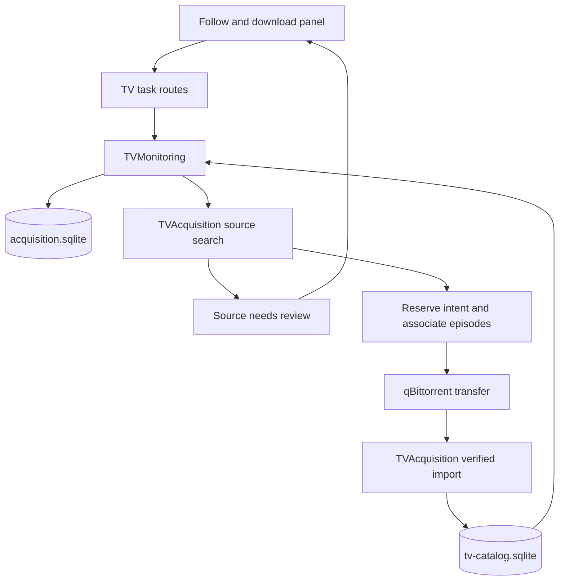

# TV Follow code map

[Approved behavior and evidence](../second-brain/tv-follow.md) · [Atlas index](README.md) · [Maintenance workflow](../knowledge-workflow.md)

**Source checked** · 2026-11-06 on `master` at `be511f9`, with local changes in the TV frontend, services, contract, and tests. The map describes that checkout. [Runtime evidence boundary](../second-brain/tv-follow.md#evidence-and-limits)

## Entry points

On an expanded, saved TV series, `TVSeriesPage` mounts `TVMonitoringControls` as **Follow and download**. The panel shows Preview targets, Save draft, and task history. Start appears on a draft row. [Series page](../../src/features/tv/TVWorkspace.jsx) · [Follow panel](../../src/features/tv/TVAcquisitionReview.jsx)

| User action | API and route handler | Owner and result |
| --- | --- | --- |
| Preview targets | `POST /api/tv/series/<series_id>/tasks/preview` → `tv_task_preview` | `TVMonitoring.preview` projects targets and readiness. Inputs include scope, action, season or episode IDs, and quality profile. |
| Save draft | `POST /api/tv/series/<series_id>/tasks` → `tv_task_save` | `TVMonitoring.save_task` stores the draft. |
| Start | `POST /api/tv/tasks/<task_id>/start` → `tv_task_start` | `TVMonitoring.start_task` rechecks readiness, resolves and reserves import homes, and marks the task running with due targets. A blocked start keeps the draft and its error. |
| View status or history | `GET /api/tv/tasks?series_id=…` with optional `history=true` → `tv_tasks` | `TVMonitoring.list_tasks` and `task` project status, counts, timestamps, and reasons. The panel polls and renders the returned data in Cairo time. |
| Upgrade | Same Preview, Save, and Start endpoints with action `upgrade` | `TVMonitoring.preview` selects eligible owned targets. `TVAcquisition.search` applies the upgrade policy. Verified publication protects the existing copy until a replacement is ready. |
| Finish this season | `POST /api/tv/tasks/<task_id>/finish-season` → `tv_task_finish_season` | `TVMonitoring.finish_season` completes a season-scoped Future task waiting for season end once its targets are acquired. |
| Cancel | `GET /api/tv/tasks/<task_id>/cancel/preview` → `tv_task_cancel_preview`, then `POST /api/tv/tasks/<task_id>/cancel` → `tv_task_cancel` | `TVMonitoring.cancel_preview` and `cancel_task` check the task's transfers and files. Confirmation sends a mode and preview token. Inspect shared transfers and existing media protections before amending this path. |

[Flask routes](../../services/tv_routes.py) · [Task lifecycle](../../services/tv_monitoring.py) · [Acquisition](../../services/tv_acquisition.py)

## Worker and data

1. **Scheduling and task state** · `app.py::_run_tv_monitor` calls `TVMonitoring.run_once` when TV is enabled and qBittorrent is in embedded mode. In `_run_once`, `_eligible_at` uses midnight Africa/Cairo for date-only Future eligibility. `_source_retry` returns `18000` seconds for persistent Missing/Future source retries. `_run_once` separately checks the `21600`-second Future metadata interval and calls `TVMetadata.refresh`. Missing keeps its Start-time target list. The worker checks verified catalog bindings and `_settle` projects waiting, review, or completion. [Worker wiring](../../app.py) · [Task and scheduling owner](../../services/tv_monitoring.py) · [Metadata refresh](../../services/tv_metadata.py)
2. **Sources and review** · `_run_missing_groups` calls `TVAcquisition.search_missing_season` and `select_automatic_plan` for eligible Missing groups, with bounded episode queries for gaps. For eligible targets outside that grouped path, `_run_once` calls `TVAcquisition.search` and `select_automatic` per episode. Both use identity, quality, coverage, and automatic trust checks on Prowlarr results. `app.py::_effective_tv_download_trusted_indexer_ids` supplies the TV trust selection. `_save_source_outcome` records group failures and review outcomes. `_run_once` persists those outcomes for the per-episode path. Source review opens `TVAcquisitionReview` for the season and uses the existing manual release flow. [Task owner](../../services/tv_monitoring.py) · [Release selection](../../services/tv_acquisition.py) · [App configuration owner](../../app.py) · [Review panel](../../src/features/tv/TVAcquisitionReview.jsx)
3. **Transfer and verified publication** · `_queue_group_decision` uses `TVAcquisition.reserve_intent` to reserve work and records the covered targets before submission. The embedded qBittorrent manager owns transfer state and job recovery in `jobs.json`. Its `process_completed` flow dispatches TV jobs to `TVAcquisition.process_completed`. For normal downloads `complete_normal_import` verifies the manifest, publishes episode files and binds them to the catalog. Track submission pending, queued, and acquired as separate states. Review after a transfer or import issue retains the existing intent for recovery. [Task association](../../services/tv_monitoring.py) · [TV acquisition and import](../../services/tv_acquisition.py) · [Transfer manager](../../services/qbittorrent.py)

| Data | Owner |
| --- | --- |
| `acquisition.sqlite` under the configured user data directory | `app.py::_acquisition_repository` opens `AcquisitionRepository`. See `tv_tasks`, `tv_task_episodes`, `tv_task_exclusions`, and `tv_task_cancellations`, plus the shared intent, claim, and notification tables. `TVMonitoring` writes the task lifecycle. [Repository](../../services/acquisition_store.py) · [Task owner](../../services/tv_monitoring.py) |
| `tv-catalog.sqlite` under the configured user data directory | `TVServices` composes the catalog owners. `TVCatalogRepository` supplies episodes, file bindings, and import-home resolution and reservation. TV metadata comes from the separate metadata owner. [Service composition](../../services/tv_services.py) · [Catalog repository](../../services/tv_catalog_repository.py) · [Metadata owner](../../services/tv_metadata.py) |

## Separate paths and shared callers

| Surface | Where it goes |
| --- | --- |
| **Download all seasons** and **Choose seasons…** below Follow | `TVSeriesPage` opens `TVAcquisitionReview`. `POST /api/tv/search/seasons` → `tv_search_seasons` → `TVAcquisition.search_seasons` builds the review. Explicit Download calls `POST /api/tv/acquisitions/batch` → `TVAcquisition.submit_batch`. This path creates no persistent Follow task. [Series page](../../src/features/tv/TVWorkspace.jsx) · [Review panel](../../src/features/tv/TVAcquisitionReview.jsx) · [Routes](../../services/tv_routes.py) |
| **Bulk Download in TV Library, TV Discover, and TV Lists** | All three use `TVBulkActionBar` to preview selected saved shows and send `POST /api/tv/bulk/download` to `tv_bulk_download`. The handler saves and starts tasks with `kind='bulk'`. `TVMonitoring._settle` completes the one-shot task once the search outcomes are known, including queued transfers and sources needing review. [Bulk entry points and transfer map](tv-downloads-and-import.md#entry-points) · [Routes](../../services/tv_routes.py) · [Worker](../../services/tv_monitoring.py) |
| **Legacy monitoring API** | `POST /api/tv/series/<series_id>/monitor` calls `tv_monitor` → `TVMonitoring.configure`. It can save and start in one request for old callers. The current desktop Follow panel uses the task endpoints above. [Legacy route](../../services/tv_routes.py) · [Compatibility owner](../../services/tv_monitoring.py) |
| **ChatGPT TV task confirmation** | `DomainTools.prepare_tv_task` calls `tv_task_preview` to prepare a proposal. On explicit confirmation, `DomainTools.confirm` checks the preview again, calls `tv_task_save`, then passes the returned draft ID to `tv_task_start`. `app.py::_ai_domain_dispatch` sends those calls to the same Flask handlers in-process. A change to Start validation or its response can affect this caller. [ChatGPT action](../../services/chatgpt_domain_tools.py) · [Flask dispatcher](../../app.py) · [Task routes](../../services/tv_routes.py) |

Movie Follow has separate search and scheduling logic. Check shared intent and transfer callers before editing those shared owners. [Movie acquisition](../../services/movie_acquisition.py) · [Shared intent store](../../services/acquisition_store.py) · [Transfer manager](../../services/qbittorrent.py)

## Tests by review question

| If changing | Start with these checks |
| --- | --- |
| Save, Start, readiness, cancellation | `test_blocked_draft_is_saved_and_start_retains_actionable_error`, `test_follow_draft_start_cancel_and_durable_notifications`, and `test_task_cancellation_protects_an_imported_file_that_is_playing`. [Download contract tests](../../tests/test_tv_download_contracts.py) · [Acquisition tests](../../tests/test_verified_tv_acquisition.py) |
| Start from ChatGPT | `test_tv_monitor_prepares_future_policy_and_uses_actual_tv_task_owner` checks that preparation stops before Save or Start and confirmation passes the returned draft task ID to Start. It uses a stub dispatcher. Pair it with the Start lifecycle tests above for real handler and service behavior. [ChatGPT confirmation test](../../tests/test_chatgpt_domain_tools.py) |
| Retry interval, restart, or air dates | `test_missing_retries_after_exactly_five_elapsed_hours_and_restart_once` and `test_future_first_search_is_cairo_midnight_including_both_dst_boundaries`. [Scheduling tests](../../tests/test_tv_download_contracts.py) |
| Packs, deferred episodes, or review | `test_follow_prefers_one_pack_and_associates_every_target`, `test_missing_snapshot_never_expands_when_later_episode_metadata_arrives`, and `test_manual_quality_is_review_and_still_retries_in_five_hours`. [Season planning tests](../../tests/test_tv_follow_season_planning.py) · [Source diagnostics tests](../../tests/test_tv_source_diagnostics.py) |
| Other download workflows | `test_multi_season_review_only_released_missing_and_explicit_submit`, `test_one_shot_bulk_reports_no_source_and_does_not_follow_future`, and `test_existing_explicit_automatic_upgrade_policy_is_preserved`. [Download workflow tests](../../tests/test_tv_download_workflow.py) · [Acquisition tests](../../tests/test_verified_tv_acquisition.py) |
| Desktop result from Start through Versions, manual review, or status polling | Use the disposable backend and compiled desktop cases for the changed path. The pack spec checks a real task, one transfer intent, verified import, and Versions. The download-contract spec checks lower manual review, blocked Start, and polling. [Season-pack desktop spec](../../tests/e2e/tv-follow-season-packs.spec.js) · [Download-contract desktop spec](../../tests/e2e/tv-download-contracts.spec.js) · [Isolated commands](../plans/2026-10-10-tv-follow-season-packs-and-source-diagnostics-plan.md#verification-and-rollout) |
