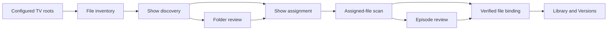

# TV Library and Maintenance code map

[Decisions and evidence](../second-brain/tv-library-and-maintenance.md) · [Atlas index](README.md) · [Downloaded-episode import](tv-downloads-and-import.md)

For a file in the Movie catalog, use the [Movie Library and Identity Review map](movie-library-and-identity-review.md).

For version selection, episode resume, or Home progress after a file is linked, use [Playback and Streaming](playback-and-streaming.md).

**Source checked** · 2026-11-07 on `master` at `be511f9`, with local changes in the TV workspace and routes. The local homepage on port 5000 was served by PID `36876` with `/assets/index-Cok6xiDI.js`. Live discovery, scan, and linking behavior remain unverified.

## Entry points

TV Library's **Review TV identity in Maintenance** shortcut comes from `TVLibraryImport`. `App` routes it to the TV Identity tab in `CleanupWorkspace`, which reads `GET /api/tv/maintenance` and renders `TVMaintenanceTab`. The response comes from `TVReadModel.maintenance`, which filters and pages folder candidates, episode-file reviews, and exclusions from the TV catalog. [Library shortcut](../../src/features/tv/TVLibraryImport.jsx) · [App navigation](../../src/App.jsx) · [Maintenance shell](../../src/features/cleanup/CleanupWorkspace.jsx) · [TV Identity controls](../../src/features/cleanup/TVMaintenanceTab.jsx) · [Read model](../../services/tv_read_model.py)

| Action | API and owner |
| --- | --- |
| **Find new TV folders** | `POST /api/tv/library/discovery` → `tv_library_discover_now` → `TVLibraryDiscovery.run`. `TVIngestion.inventory` reads supported files under configured roots. `_match` uses title, year, and episode evidence to choose an eligible TMDB TV candidate. `run` can refresh its metadata and assign a folder when the evidence is sufficient. Other outcomes appear in folder review or scan error. `GET /api/tv/library/inventory` is the bounded read-only file inventory. `GET /api/tv/library/discovery` returns the current discovery snapshot. [Routes](../../services/tv_routes.py) · [Discovery owner](../../services/tv_library_discovery.py) · [Inventory owner](../../services/tv_ingestion.py) |
| **Assign a folder to a show** | `TVMaintenanceTab.approveFolder` saves or refreshes the selected series through `POST /api/tv/series`, then sends its local ID and path to `POST /api/tv/library/assignments`. `tv_library_approve` calls `TVIngestion.approve` → `TVCatalogRepository.approve_path`. The API accepts `kind='folder'` or `kind='file'`. The current TV Identity action sends `folder`. Assignment records ownership for later scanning. [Maintenance controls](../../src/features/cleanup/TVMaintenanceTab.jsx) · [Routes](../../services/tv_routes.py) · [Assignment checks](../../services/tv_ingestion.py) · [Assignment store](../../services/tv_catalog_repository.py) |
| **Scan assigned TV files** | `POST /api/tv/library/scan` → `tv_library_scan` → `TVIngestion.scan_approved`. It skips exclusions and unassigned files, uses the most specific assignment for a file, and skips unchanged bindings with the same owner. A conflicting nested folder goes to episode-file review. Recognized nested extras can become exclusions. [Route](../../services/tv_routes.py) · [Scan owner](../../services/tv_ingestion.py) |
| **Link a file from episode review** | `TVMaintenanceTab.applyEpisode` looks up local episode IDs for the selected season and numbers. `POST /api/tv/review/<review_id>/apply` → `tv_apply_review` → `TVIngestion.apply_review`. The owner checks the selected episodes belong to the review's series, verifies playable media facts, saves the binding, and marks the review applied. [Review controls](../../src/features/cleanup/TVMaintenanceTab.jsx) · [Routes](../../services/tv_routes.py) · [Review owner](../../services/tv_ingestion.py) |
| **Exclude a file or folder, or remove an exclusion** | `POST` or `DELETE /api/tv/maintenance/exclusions` updates exclusion records through `TVCatalogRepository.exclude_path` or `remove_exclusion`. The assigned scan consults those records. [Maintenance controls](../../src/features/cleanup/TVMaintenanceTab.jsx) · [Routes](../../services/tv_routes.py) · [Exclusion owner](../../services/tv_catalog_repository.py) |
| **Import existing files from an expanded series** | `TVIngestion.jsx` exposes a series-scoped folder scan through `POST /api/tv/series/<series_id>/scan` → `TVIngestion.scan`. It scans a specified folder inside TV roots for the selected series. **Discover from Plex** calls `/plex-scan` → `ingest_plex` for the selected TMDB series. Both paths feed the same ingestion owner and use the same explicit review route. [Series panel](../../src/features/tv/TVIngestion.jsx) · [Routes](../../services/tv_routes.py) · [Ingestion owner](../../services/tv_ingestion.py) |

## Matching and Library visibility

1. **Configuration and background work** · `app.py` loads TV roots from `tv_roots` and wires `TVServices` to the configured user data directory. The TV owners use `tv-catalog.sqlite`. `_run_tv_library_scan` can run discovery, scan approved assignments, and hydrate episode metadata while TV is enabled. The **Refresh TV catalog** button reloads the view. The Maintenance scan and discovery buttons call separate write routes. [Worker and configuration](../../app.py) · [Service wiring](../../services/tv_services.py) · [Library view actions](../../src/features/tv/TVWorkspace.jsx)
2. **Episode identity** · `TVIngestion.ingest` checks root containment and video type, then uses `parse_episode_name` and `resolve_episode_claim` with the local episode catalog and any season hint. Folder-owned files also get a title check when applicable. A successful probe and stable file facts allow `TVCatalogRepository.bind_file` to record a file at its existing path and link it to the episode IDs. A needs-review result records an ingestion candidate. Durable assignments, discovery results, review items, exclusions, and bindings live in the TV catalog. [Ingestion](../../services/tv_ingestion.py) · [Filename and episode parser](../../services/tv_filename_parser.py) · [Binding owner](../../services/tv_catalog_repository.py) · [Schema](../../services/tv_catalog_store.py)
3. **Read the exact episode** · `GET /api/tv/series/<series_id>/seasons/<season>` → `tv_season` → `TVCatalogRepository.episodes` returns versions and availability. A version's stored availability and existence at its saved path are both checked. The series page shows **Versions** for cataloged copies. **File View** uses `GET /api/tv/files` → `TVReadModel.files` to display cataloged paths, episode mappings, and the stored availability flag. Use the season response to confirm current path availability. [Season and file routes](../../services/tv_routes.py) · [Episode read](../../services/tv_catalog_repository.py) · [File read](../../services/tv_read_model.py) · [File View](../../src/features/tv/TVFileView.jsx) · [Versions](../../src/features/tv/TVWorkspace.jsx)

## File exists but the episode is missing

| Case | Where to look | Existing test |
| --- | --- | --- |
| **Unassigned folder or file** | Check the configured root and the inventory's assignments. A folder review or scan error can explain why discovery withheld assignment. Assigned-file scanning skips files without a matching assignment. | `test_unapproved_paths_are_not_linked_and_approval_stays_within_root` and `test_unique_year_and_numeric_tv_identity_create_cards_without_manual_mapping`. [Import tests](../../tests/test_tv_library_import.py) · [Discovery tests](../../tests/test_tv_library_discovery.py) |
| **Unresolved or conflicting episode match** | Check the episode-file row in **TV Identity** for its reason and the assigned series. A nested show conflict can require a more specific assignment. A known show with ambiguous numbering can require explicit episode mapping. | `test_nested_show_folder_blocks_a_parent_assignment` and `test_reassignment_keeps_existing_binding_and_requests_review`. [Import tests](../../tests/test_tv_library_import.py) |
| **Excluded file or ancestor folder** | Check **TV Identity → exclusions** and the exact path. An exclusion can come from an explicit decision or the assigned scan's nested-extras rule. Removing it allows the scan to evaluate the path again under the current rules. | `test_fixed_match_closes_prior_review_and_extras_stay_unbound`. [Import tests](../../tests/test_tv_library_import.py) |
| **Unavailable cataloged version** | Compare the saved **Versions** path with the file's current path. A missing file or a stored unavailable flag keeps that version unavailable. An existing binding can still appear in File View. | `test_unavailable_version_selection_is_preserved` and `test_stored_unavailable_versions_remain_unplayable_when_files_exist`. [Catalog tests](../../tests/test_tv_catalog.py) |

An existing file with a cleared availability flag can be skipped by `scan_approved` when the saved owner, size, and modified time still match. The series-scoped **Scan this folder** path rechecks media and identity. If it verifies the same episode binding, `bind_file` restores the stored availability. This behavior was traced in source. [Scan owners](../../services/tv_ingestion.py) · [Binding update](../../services/tv_catalog_repository.py)

**Cross-surface checks** · `test_http_inventory_approval_and_scan_use_the_same_ingestion_owner` checks the API from inventory through approval and binding. The desktop parity spec checks that the Library shortcut selects **TV Identity**. Those checks cover different parts of the workflow. [API integration test](../../tests/test_tv_library_import.py) · [Desktop shortcut test](../../tests/e2e/tv-parity.spec.js)
